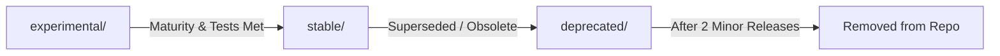

# Maintenance and Governance Guide

This document defines the contribution workflow, quality standards, versioning rules, and governance policies for developing and maintaining artifacts in this repository.

*Consulte a versão em [Português (Brasil)](./manutencao.pt-BR.md).*

---

## 1. Creating or Modifying Artifacts

All skills must adhere to the open [Agent Skills Specification](https://agentskills.io/specification).

### 1.1 Directory Anatomy
```text
[stable | experimental | deprecated]/
├── skills/<skill-name>/
│   ├── SKILL.md              # Mandatory: frontmatter + core instructions
│   ├── references/           # Optional: extended documentation loaded on-demand
│   ├── templates/            # Optional: scaffold templates or code snippets
│   └── assets/               # Optional: static assets (diagrams, schemas)
├── agents/<agent-name>.md    # Subagent persona definition (Cursor & Claude Code)
├── hooks/                    # Automation and lifecycle hooks
└── rules/                    # System prompt context rules
```

### 1.2 `SKILL.md` Specification
The `SKILL.md` file MUST start with a YAML frontmatter block:

```yaml
---
name: my-skill-name
description: Clear, action-oriented description (<1024 characters) explaining what the skill does and exactly when an agent should invoke it.
license: MIT
metadata:
  category: engineering
  tags: "testing, refactoring, quality"
---

# My Skill Title

## When to Apply
...
```

#### Frontmatter Field Constraints:
- **`name`**: Max 64 characters, lowercase alphanumeric and hyphens only (`^[a-z0-9]+(-[a-z0-9]+)*$`). **Must match the parent directory name exactly**.
- **`description`**: Max 1024 characters. Non-empty. Must provide unambiguous trigger conditions.
- **`license`**: License name (e.g., `MIT`) or relative path to a local license file.

### 1.3 Progressive Disclosure Principle
- Keep `SKILL.md` concise. Never paste reference books or entire API documentations directly into the main file.
- Move auxiliary checklists, detailed domain rules, or secondary templates into `references/`. The agent will dynamically read them only when the specific execution path demands it.

---

## 2. Testing and Automated Quality Checks

Before submitting any modification or creating a pull request, run the automated verification suite:

```bash
# 1. Validate frontmatter, kebab-case, directory shapes, and schema integrity
node tools/validate-catalog.js

# 2. Check catalog.json synchronization with the filesystem
node tools/validate-catalog.js
```

### Acceptance Test Requirements:
For every new skill (or significant modification to existing skills), propose three synthetic regression test cases:
1. **Activation Case**: A user prompt that cleanly triggers the skill.
2. **Non-Activation / Neutrality Case**: A related user prompt where the skill should remain dormant.
3. **Failure / Rule-Enforcement Case**: A synthetic fixture with an intentional violation that the skill must catch and correct.

---

## 3. Versioning Policy & Breaking Changes

Each artifact is independently versioned inside `catalog.json` using Semantic Versioning (`MAJOR.MINOR.PATCH`):

| Bump Type | Trigger Condition | Example |
| :--- | :--- | :--- |
| **`PATCH`** (`1.0.0` → `1.0.1`) | Typo fixes, minor clarifications, non-semantic wording updates | Correcting markdown formatting or fixing a typo in an example |
| **`MINOR`** (`1.0.0` → `1.1.0`) | Adding new backward-compatible capabilities, examples, or optional parameters | Adding a new synthetic example or supporting a new language template |
| **`MAJOR`** (`1.0.0` → `2.0.0`) | Breaking changes to triggers, input/output contract, or removal of existing rules | Inverting default behavior, deprecating arguments, or restructuring outputs |

### Communicating Breaking Changes
- Major version increments MUST include a dedicated section in `CHANGELOG.md`.
- Update the `catalog.json` entry with a clear note under `releaseNotes`.
- If an older behavioral contract must be maintained for backward compatibility, keep the old version under `deprecated/` for a deprecation window of at least two minor releases.

---

## 4. Promotion, Demotion & Deprecation Flow



### 4.1 Promotion Criteria (`experimental/` → `stable/`)
1. **Field Validation**: Documented successful usage across multiple sessions without reported prompt-injection or tool-looping regressions.
2. **Test Coverage**: All 3 synthetic regression tests implemented and passing in CI.
3. **Bilingual Documentation**: English and Portuguese documentation complete and aligned.
4. **Clean DLP Audit**: Zero proprietary terms, internal paths, or non-public data in the artifact files.

### 4.2 Deprecation Criteria (`stable/` → `deprecated/`)
1. Add a clear deprecation alert at the top of `SKILL.md`:
   ```markdown
   > [!WARNING]
   > This skill is deprecated and will be removed in release v2.0.0. Please migrate to `stable/skills/new-skill-name`.
   ```
2. Mark `"status": "deprecated"` in `catalog.json`.
3. Retain the artifact in `deprecated/skills/` for at least two minor release cycles to give users time to update their symlinks.

---

## 5. Governance, Licensing & Authorization

- **Repository Maintainer**: Alessandro Emerich retains final authority on all promotions, releases, and architectural decisions.
- **Licensing Authority**: The repository owner determines the licensing of newly contributed code (default: **MIT License**).
- **Third-Party Rights & Origin Verification**:
  - Code derived from proprietary internal projects is strictly forbidden from direct copy-pasting.
  - Ideas, patterns, and architectural abstractions from past professional experience may only be contributed through **independent, de novo re-authoring** using synthetic examples and public domain references.
  - Any uncertainty regarding IP or authorization blocks an artifact from `stable/` until explicitly resolved and approved by the maintainer.

