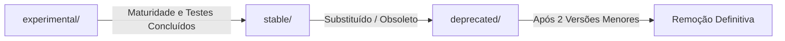

# Guia de Manutenção e Governança

Este documento estabelece o fluxo de contribuição, padrões de qualidade, regras de versionamento e políticas de governança para o desenvolvimento e manutenção dos artefatos deste repositório.

*Consulte a versão principal em [Inglês](./maintenance.md).*

---

## 1. Criação e Modificação de Artefatos

Todas as skills devem seguir rigorosamente a [Especificação Agent Skills](https://agentskills.io/specification).

### 1.1 Anatomia de Diretórios
```text
[stable | experimental | deprecated]/
├── skills/<nome-da-skill>/
│   ├── SKILL.md              # Obrigatório: frontmatter YAML + instruções centrais
│   ├── references/           # Opcional: documentação estendida carregada sob demanda
│   ├── templates/            # Opcional: scaffolds ou modelos de código
│   └── assets/               # Opcional: imagens, diagramas e esquemas estáticos
├── agents/<nome-agente>.md   # Definição canônica de subagente (Cursor e Claude Code)
├── hooks/                    # Gatilhos de automação e ciclo de vida
└── rules/                    # Regras de contexto de sistema para IAs
```

### 1.2 Especificação do `SKILL.md`
O arquivo `SKILL.md` DEVE iniciar com um bloco YAML delimitado por `---`:

```yaml
---
name: nome-da-minha-skill
description: Descrição concisa e orientada à ação (<1024 caracteres) explicando o que a skill faz e exatamente quando o agente deve utilizá-la.
license: MIT
metadata:
  category: engineering
  tags: "testing, refactoring, quality"
---

# Título da Skill

## Quando Aplicar
...
```

#### Regras do Frontmatter:
- **`name`**: Máximo de 64 caracteres, apenas letras minúsculas, números e hífens (`^[a-z0-9]+(-[a-z0-9]+)*$`). **Obrigatoriamente idêntico ao nome do diretório pai**.
- **`description`**: Máximo de 1024 caracteres. Não vazio. Deve conter gatilhos explícitos e sem ambiguidade.
- **`license`**: Nome da licença permissiva (ex: `MIT`) ou caminho relativo para arquivo de licença local.

### 1.3 Princípio da Divulgação Progressiva (*Progressive Disclosure*)
- Mantenha o `SKILL.md` enxuto e conciso. Nunca copie livros inteiros ou manuais exaustivos de API diretamente no corpo principal.
- Desloque checklists secundários, tabelas extensas ou templates auxiliares para a pasta `references/`. O agente fará a leitura dinâmica via ferramentas de arquivo apenas quando a linha de raciocínio demandar.

---

## 2. Testes e Validação Automatizada de Qualidade

Antes de abrir qualquer Pull Request ou submeter alterações, execute a suíte de conferência:

```bash
# 1. Validar integridade de frontmatter, nomes em kebab-case e estrutura de pastas
node tools/validate-catalog.js

# 2. Conferir sincronização entre o catalog.json e o sistema de arquivos
node tools/validate-catalog.js
```

### Requisitos de Casos de Teste de Aceitação:
Para cada nova skill ou alteração significativa, elabore três casos de teste de regressão sintéticos:
1. **Caso de Ativação**: Prompt que aciona a skill de forma limpa e esperada.
2. **Caso de Não-Ativação / Neutralidade**: Prompt relacionado onde a skill deve permanecer dormente.
3. **Caso de Falha / Imposição de Regra**: Fixture sintética contendo uma violação intencional que a skill deve identificar e corrigir.

---

## 3. Política de Versionamento e Quebras de Contrato

Cada artefato possui versão semântica independente no `catalog.json` (`MAJOR.MINOR.PATCH`):

| Tipo de Incremento | Condição Disparadora | Exemplo |
| :--- | :--- | :--- |
| **`PATCH`** (`1.0.0` → `1.0.1`) | Correção de digitação, formatação ou ajustes de clareza sem impacto semântico | Ajuste de markdown ou correção ortográfica em exemplo |
| **`MINOR`** (`1.0.0` → `1.1.0`) | Novas capacidades retrocompatíveis, novos templates ou novos exemplos sintéticos | Adição de novo exemplo sintético ou template para nova linguagem |
| **`MAJOR`** (`1.0.0` → `2.0.0`) | Mudança incompatível em gatilhos, no contrato de entrada/saída ou eliminação de regras | Inversão do comportamento padrão ou alteração estrutural da saída |

### Comunicação de Mudanças Incompatíveis
- Toda alteração `MAJOR` exige entrada detalhada em `CHANGELOG.md`.
- Atualize a respectiva entrada no `catalog.json` com notas no campo `releaseNotes`.
- Quando necessário manter compatibilidade temporária com clientes legados, preserve o artefato antigo sob `deprecated/` durante um período de transição de pelo menos duas versões menores.

---

## 4. Fluxo de Promoção, Rebaixamento e Depreciação



### 4.1 Critérios de Promoção (`experimental/` → `stable/`)
1. **Validação Prática**: Histórico de uso consistente em sessões reais sem registros de desvios ou loops de chamadas.
2. **Cobertura de Testes**: 3 casos de teste sintéticos implementados e validados no CI.
3. **Documentação Bilíngue**: Manuais em Inglês e Português alinhados e completos.
4. **Auditoria Limpa de Dados**: Zero termos proprietários, caminhos de diretório pessoal ou dados confidenciais.

### 4.2 Critérios de Depreciação (`stable/` → `deprecated/`)
1. Inserir aviso de substituição destacado no topo do `SKILL.md`:
   ```markdown
   > [!WARNING]
   > Esta skill está descontinuada e será removida na versão v2.0.0. Migre para `stable/skills/novo-nome`.
   ```
2. Alterar o status para `"deprecated"` no `catalog.json`.
3. Manter o artefato acessível em `deprecated/skills/` por pelo menos dois ciclos de release minor para permitir a migração dos symlinks dos usuários.

---

## 5. Governança, Licenciamento e Autorização

- **Responsável Técnico / Mantenedor**: Alessandro Emerich detém a autoridade final sobre releases, promoções de canal e arquitetura.
- **Autoridade de Licenciamento**: O mantenedor define as licenças do material original aceito no projeto (padrão **Licença MIT**).
- **Proteção de Propriedade Intelectual e Verificação de Origem**:
  - É expressamente proibida a cópia direta de código de projetos corporativos ou internos anteriores.
  - Abstrações conceituais e padrões de engenharia aprendidos no percurso profissional são admitidos exclusivamente via **re-autoria original e independente**, fundamentada em literatura pública e exemplificada com cenários sintéticos.
  - Qualquer item com status de licença incerto ou pendência legal permanece bloqueado fora do canal `stable/` até resolução e liberação formal pelo mantenedor.

